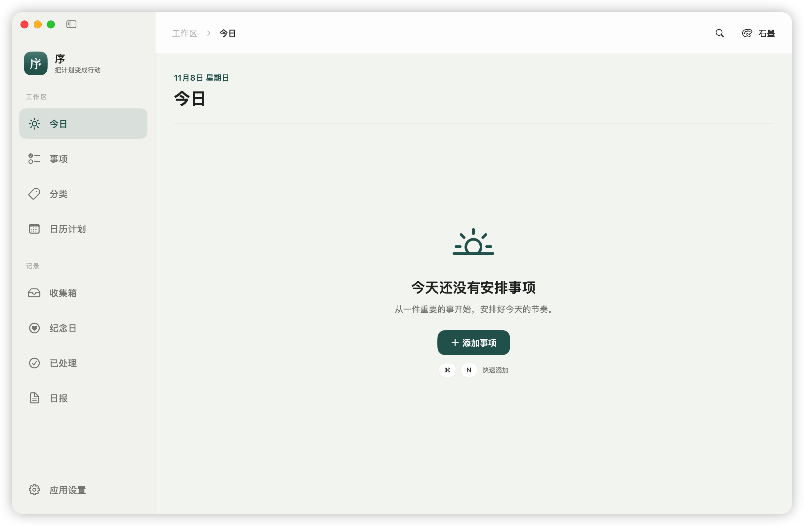

# 序 · Flutter macOS Design System

版本：1.1（2026-11-08）。适用范围：本仓库的 Flutter 3.47.9 / macOS 14+ 主应用。`flutter/lib/` 与 `flutter/macos/` 是实现位置；`legacy-macos/Sources/` 和本目录上层的旧文档只提供设计与行为参照，`iOS/` 不在范围内。

## 设计方向

「序」是一张安静、清楚、可持续使用的工作台。**默认视觉以用户提供的「今日」界面为锚点**：浅石墨灰绿背景、深青绿强调色、分组侧栏、克制的顶部工具区和有明确下一步的空态。任务、时间、进度与下一步比装饰更显眼。页面应像 macOS 应用：侧边栏稳定、键盘可达、窗口可缩放、系统能力的状态可辨认。



图片是**视觉与信息层级参照**，不是 Flutter 已实现界面的截图，也不是像素级复刻要求。默认浅色的主要底色与强调色从图中采样；深色、错误态及复杂业务页由同一语义体系推导并单独验收。

继承旧版的四条核心规则：

1. **一条任务，多种视图。** 今日、事项、四象限、日历和任务蓝图显示同一任务；切换视图不复制数据或改变状态。
2. **任务系列有边界。** 根任务与后代组成独立卡片，默认收起；展开只影响当前系列，计数始终按任务 ID。
3. **规划与执行分明。** 蓝图说明目标与步骤，日历说明时间；截止时间不是执行时间，父子关系不是前置依赖。
4. **状态明确。** 待办、进行中、阻塞、完成、取消、未安排均有文字及图标；空数据、无筛选结果、加载失败和无权限不能共用同一空态。

## 规范的层级

| 层级 | 文档 | 负责的问题 |
| --- | --- | --- |
| 基础 | [Foundations](foundations.md) | 语义色、字体、尺寸、主题、密度、响应式、动效 |
| 组件 | [Components](components.md) | 控件状态、卡片、表单、弹窗、反馈及桌面交互 |
| 页面 | [Page patterns](page-patterns.md) | 导航、事项/蓝图/日历等页面结构与信息顺序 |
| 验收 | [Validation](validation.md) | 截图、键盘、VoiceOver、窗口尺寸和实施顺序 |

决策顺序：先使用 Flutter/macOS 提供的语义与交互能力，再使用本规范的 token 和可复用组件；业务规则仍由 Repository/ViewModel 负责。不要把旧 SwiftUI 的 `AppCard`、`AppButton` 或 `appDialog` 名字当成 Flutter 已存在的组件。

## 目标与现状

当前 Flutter 已将石墨浅/深主题接入主窗口，并在 `flutter/lib/src/design_system/` 提供无业务的 `XuSidebar`、`XuTopBar`、`XuEmptyState`。今日页已使用日期、分隔线和完整空态。其他业务页面仍有局部 `Card`、`ListTile`、`AlertDialog` 和固定间距，需逐页比对旧版并迁入同一组件体系。旧版更多主题、字体、密度与高对比度偏好尚未复原。具体功能状态见[迁移进度](../../FLUTTER-MIGRATION.md)。

已建立的组件目录与后续扩展位置：

```text
design_system/
  xu_theme.dart         // 已实现 ColorScheme、TextTheme、ThemeExtension
  components/xu_shell.dart  // 已实现侧栏、顶部栏、空态
  xu_tokens.dart        // 后续收敛尺寸、动效与布局阈值
  gallery/              // 后续组件视觉与状态样例
```

颜色和尺寸经 `Theme.of(context)`、`ColorScheme`、`ThemeExtension` 或统一常量读取。业务数据可以携带蓝图/分类自定义颜色，但显示时必须经过主题对比度处理。旧版主题预设的复原属于后续实现，不因写入本规范而自动生效。

## 评审原则

- 内容层级先于装饰：一个页面只有一个明确主动作；次要操作按频率进入工具栏或菜单。
- 系统状态先于乐观提示：保存、同步、日历授权、AI 生成和更新都有进行中、成功、失败与恢复路径。
- 默认可访问：不用颜色单独表达状态；可见焦点、快捷键提示、语义标签与等效操作是组件定义的一部分。
- 页面用真实中文长文案和混合状态验收。空数据截图只能证明空态，不能证明卡片与复杂交互。
