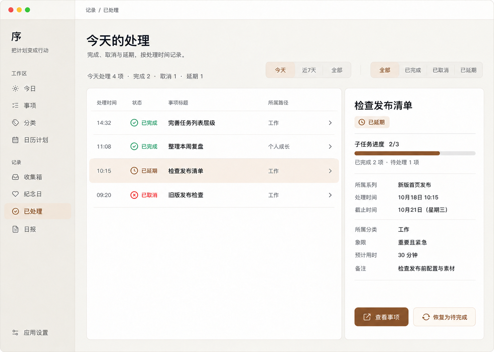

# macOS「已处理」页面 V1

本稿于 2026-10-18 确认并用于 macOS 页面实现。左侧按处理时间倒序列出当前仍为已完成、已取消或已延期的事项；点击行后，右侧显示该事项的只读摘要。默认范围为今天，可切换近 7 天或全部，并按处理结果筛选。顶部摘要统计当前时间范围内的任务数，不受结果筛选影响。

右侧显示状态；有直接子任务时显示完成数与进度；有上级系列时显示系列名称；随后显示处理时间、可用的截止时间、分类、象限、预计用时和非空备注。已按评审意见移除「原计划」和「新计划」。无子任务时不显示空进度条。

任务集合目前保存的是每项任务的最新状态和相应时间，不是状态变更事件流。「全部」只展示当前仍处于已处理状态的事项，恢复后的事项不作为旧记录继续显示；缺少处理时间的旧任务可在「全部」看到，并标为「时间未记录」。恢复操作继续使用现有 `TaskStore.restore`，父子任务与工作流依赖规则不变。

实现使用现有 macOS 侧边栏、主题偏好、`AppTypography.desktop`、`AppSpacing`、`AppRadius`、`AppCard`、`AppButton` 与系统图标。窄窗口将详情移到列表下方。设计图中的示例事项和时间仅用于说明布局。
