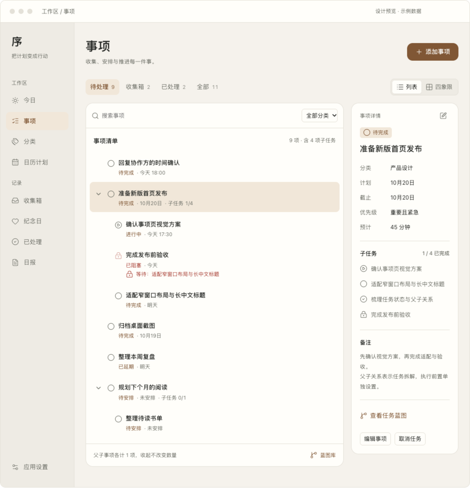
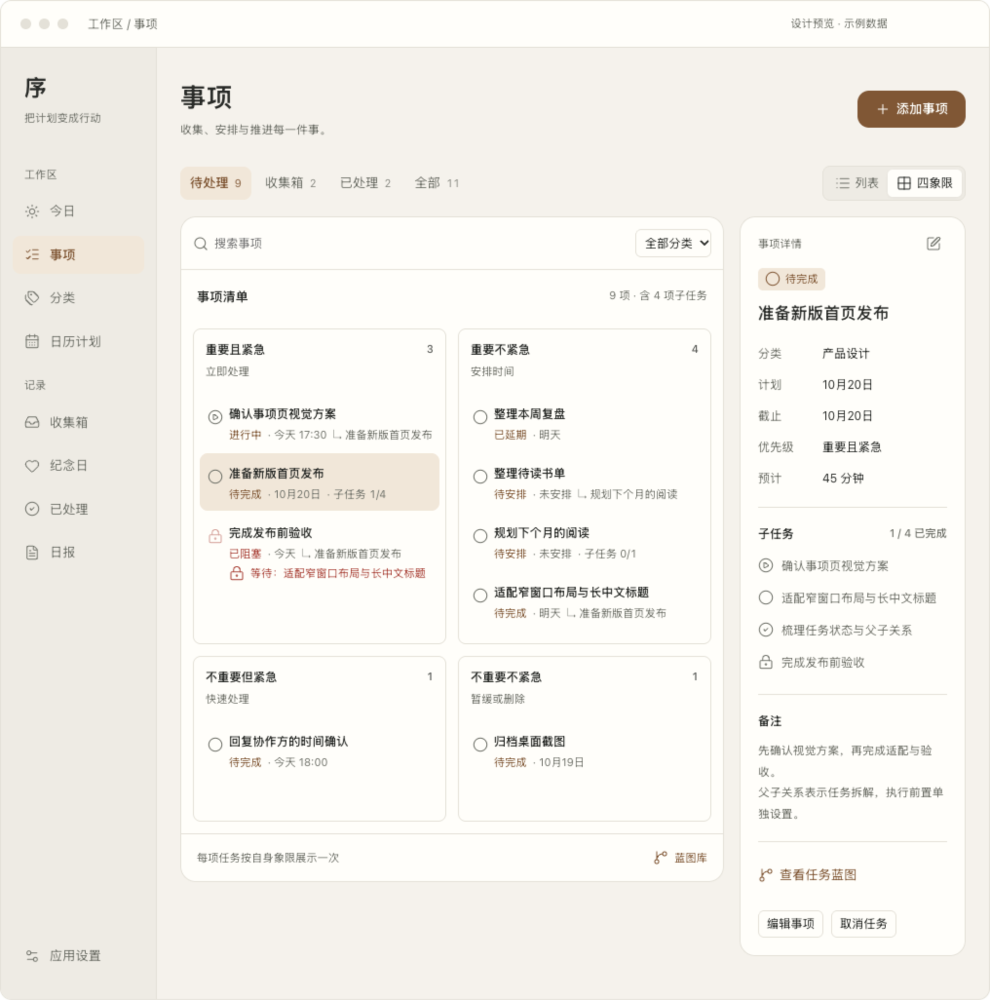
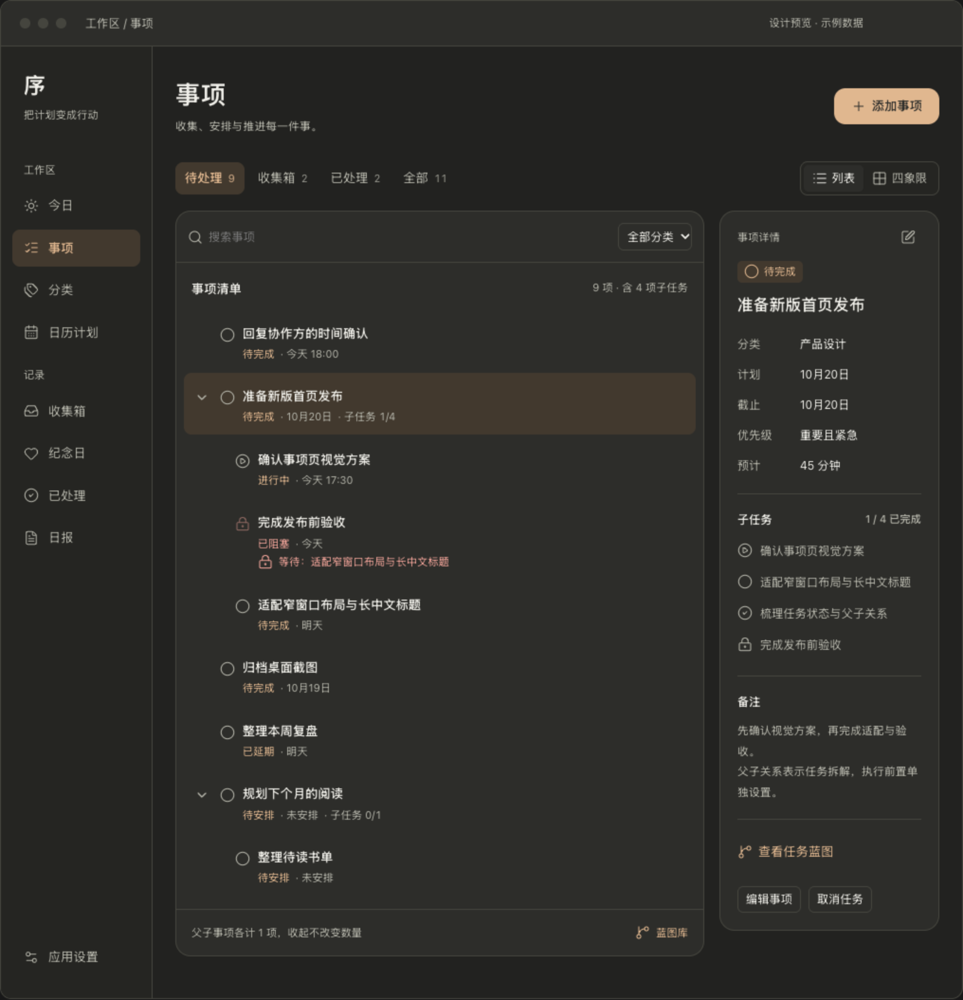
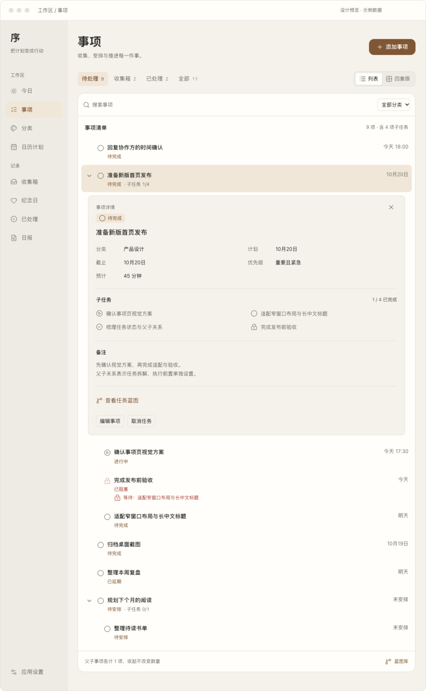
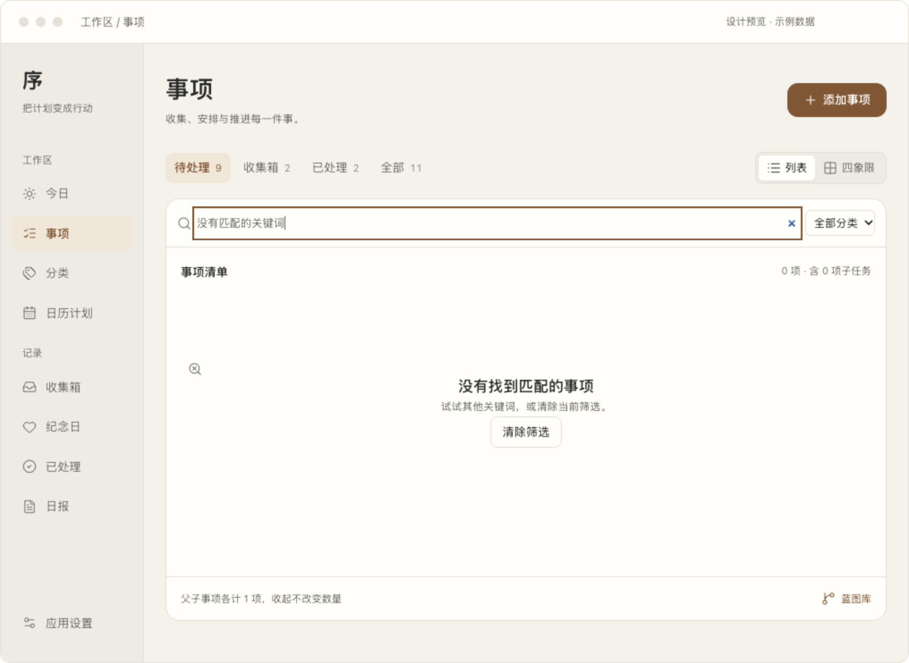

# macOS「事项」页面：视图与层级设计稿

日期：2026-10-17。基于当前工作区的 `TasksHubView`、`TaskList`、`TaskCard`、`TaskItem`、`TaskTreeProjection` 及任务视图架构整理。**本轮交付设计稿与交互原型，尚未迁移 SwiftUI 业务页面。**原型只使用内存示例，不读取或保存用户的任务数据。

[打开交互设计稿](tasks-macos-concept.html)。预览底部可切换「层级工作台」和「轻量浏览」。推荐前者用于宽窗口；后者提供完整宽度的列表，选中事项后在行下展开详情。侧边栏只用于标明现有应用导航，未模拟其他页面。

## 推荐稿：层级工作台

## 备选稿：轻量浏览

此方案把日期移到标题右侧，详情按需在当前事项下展开。减少常驻面板，更适合连续处理事项。两种方案的任务身份、范围、计数及状态语义相同。

## 当前逻辑与问题

| 当前实现 | 对使用的影响 | 设计处理 |
| --- | --- | --- |
| 页头用较长的实现概念解释任务和视图 | 首屏没有直接指向当前操作 | 标题「事项」加一句简短用途说明；结构规则留在设计文档 |
| 展示方式、蓝图库、范围筛选放入同一张控制卡 | 查看范围和展示方式的层级容易混淆 | 范围放左侧，列表/四象限放右侧；搜索与分类归属内容区；蓝图库作为次级目的地 |
| `TaskList` 已支持递归展开；祖先不在筛选结果中时，子项提升为根行 | 独立日期、状态或类别筛选后丢失归属线索 | 列表补充祖先上下文；有明确「不计入结果」文字，不能直接完成上下文行 |
| `TaskCard` 同时显示项目、分类、象限、预计时长、截止时间、子项进度及操作 | 任务标题与状态被多种元数据争夺注意力 | 主列表突出标题、状态、日期、子项进度；分类、备注等进入详情；四象限不重复写当前象限 |
| 取消操作与完成操作在每一行并列 | 高频完成与低频取消的视觉层级接近 | 行内保留完成与展开；取消进入详情或正式实现的更多菜单 |
| 页头总项数包含主任务与子任务，但未解释口径 | 收起任务或切换视图时容易误解数量 | 展示「9 项 · 含 4 项子任务」，并注明父子各计一项、收起不改数量 |
| 空态按范围区分有限 | 没有任务、没有搜索结果和收集箱为空的下一步不同 | 采用针对当前原因的标题、说明与清除筛选动作 |

## 信息架构

页面层级依次为：应用导航 → 页头与唯一添加入口 → 范围及展示方式 → 内容内搜索/分类 → 任务行 → 选中事项详情。没有额外的统计仪表盘。

| 维度 | 选项或行为 | 边界 |
| --- | --- | --- |
| 范围：看哪些事项 | 待处理、收集箱、已处理、全部 | 收集箱是待处理的子集；这些数字不可相加当作总数 |
| 展示：如何看 | 列表、四象限 | 切换不改任务、不清除范围/搜索/分类 |
| 结构：任务属于谁 | `parentTaskID` 形成层级 | 父子拆解与执行依赖分开；父子可拥有不同象限、安排与状态 |
| 详情：处理当前一项 | 分类、计划、截止、优先级、预计时长、子任务、备注 | 计划日期与截止日期分别显示，不用一个「日期」字段掩盖差别 |
| 任务蓝图 | 从当前事项进入其任务结构 | 使用原任务 ID；不复制任务，不额外创建同名的持久化蓝图 |
| 蓝图库 | 页内次级入口 → 蓝图索引 → 返回事项 | 兼容旧 `BlueprintItem`；空的旧蓝图也应保留。原型仅演示派生任务蓝图索引 |

搜索、分类与按需详情是本稿提出的新增呈现能力，当前 `TasksHubView` 尚未提供；正式实现时需接入现有 store 与原生控件。

## 状态与操作语义

| 范围 | 与当前实现一致的判断 |
| --- | --- |
| 待处理 | `needsAction`，包含待安排、待完成、进行中、已延期、已阻塞 |
| 收集箱 | `isUnscheduled && needsAction`；不能仅根据是否有截止日期判断 |
| 已处理 | 已完成或已取消；延期仍在待处理 |
| 全部 | 所有 `TaskItem` |

完成子任务只更新该任务；所有子项完成也不自动完成主任务。子项进度按全部直接子项计算（已完成 / 全部直接子项），不随当前范围变化，也不把已取消当作已完成。正式实现继续复用现有完成/恢复/取消/阻塞规则。

列表状态图标与文字共同表达状态；阻塞原因直接可见。正式实现中，`executionBlockReason(for:)` 返回原因时，完成和开始执行沿用当前禁用规则并提供原因，不能绕过 store。原型对示例中的依赖阻塞任务禁用完成按钮，并显示前置原因；未完整复制生产执行校验。

低频的开始执行、延期、标记阻塞、调整象限、日历写入及删除在正式实现中保留现有更多菜单；删除主任务仍沿用现有确认与解除子关联规则。原型只实现完成/恢复、取消、安排到今天、名称编辑和创建，用于检查信息层级；未模拟全部业务操作。

## 筛选、树与计数规则

1. 先按范围、搜索与分类求交集，得到命中 ID 集合。范围徽标显示各自范围总量，内容右上角显示当前交集数量。
2. 列表为命中子项补足祖先链。上下文行使用轻底色与「父任务上下文 · 不计入结果」文字；可选择查看详情，不能在上下文行直接完成。
3. 计数按唯一任务 ID 去重；父任务与子任务各计一项。上下文不计入；折叠只改变展示，不改变命中数。子任务进度仍取全体直接子项。
4. 四象限按命中任务自身的 `quadrant` 分组，每项只出现一次；子项显示父任务名称，不将未命中的祖先补进象限，也不强迫子项跟随父项象限。
5. 父项下的子项按各自排序规则展示。正式实现继续保留现有「待处理在前、截止时间升序、创建时间降序」规则；不存在截止日期的任务置后，不能擅自把计划日期当成截止日期排序。
6. 范围或搜索切换后，选中项若既非命中项也非其上下文，详情切换到当前结果中的一项；无结果则收起详情。视图切换保留仍有效的选中 ID。
7. 完成、取消和安排日期后重新投影同一组 ID，不从旧结果中复制任务。父任务丢失、自引用、循环关联等旧数据边界，正式实现继续使用投影层的有限遍历保护，避免隐藏任务或无限递归。

## 创建后的衔接

保留当前「待办 / 已完成 / AI 生成」创建类型与已有表单，在正式页面仅保留一个 `AppButton` 添加入口。原型表单为验证结构而简化，不替代当前 `TaskComposerView`。

普通任务保存后在所在范围可见并选中。未安排任务进入收集箱。有子任务时继续沿用「添加并查看蓝图」方向，创建主任务和子任务后查看同一任务结构；连续添加开启时仍保持输入，不强制跳转。属于旧蓝图的任务回到对应旧蓝图。原型演示无既有蓝图、未安排日期、非连续添加的分支。

## 空态与适配

- 待处理为空：说明已无待处理事项，保留页头唯一添加入口。
- 收集箱为空：说明暂不安排的任务会出现在这里；不要求用户为填满界面而新建。
- 已处理为空：说明已完成、已取消的事项会出现在这里。
- 搜索或分类无结果：显示「没有找到匹配的事项」和「清除筛选」，保留当前输入便于调整。
- 列表与详情在宽窗口并列；窄窗口改为纵向重排。轻量浏览方案在任务下展开详情。320/390px 检查仅用于压力验证，不代表新增 iOS 页面设计。
- 使用系统字体，主标题和任务标题保持自然换行；正式 SwiftUI 实现须接入 `AppTypography.desktop`、字体/字号与密度偏好。
- 浅深色、主题强调色、文字标签、键盘路径与 Reduce Motion 都是落地条件；浏览器原型不能替代 VoiceOver 与 macOS 原生控件验收。

## SwiftUI 落地映射

| 设计元素 | 复用与实现位置 |
| --- | --- |
| 页面容器与视图/范围状态 | `TasksHubView`；仅改变呈现状态，不改变模型 |
| 唯一添加入口 | `AppButton(size: .prominent)`，保留当前创建回调 |
| 范围、搜索与分类 | 原生 Button / TextField / Picker；由任务集合生成投影 |
| 列表树与上下文 | 参考 `TodayTaskOutline` 的祖先补全、上下文及有限遍历思路；不直接绑定今日日期语义 |
| 任务状态及行内操作 | 复用 `TaskCard` 的 store 操作与校验；逐步提取可读的列表呈现，避免影响其他页面 |
| 详情与编辑 | 页内只读详情加动作；编辑继续打开 `TaskEditor` |
| 四象限 | 复用 `QuadrantPanel` 的分组语义，子项加父任务提示 |
| 任务蓝图与旧蓝图 | 复用 `TaskBlueprintNavigation` 和现有投影/路由；保留旧规划元数据 |
| 表面、字体、间距、按钮、状态 | `AppColors`、`AppTypography`、`AppSpacing`、`AppRadius`、`AppTheme`、`AppCard`、`AppBadge`；原型样式仅用于评审，不能复制为业务硬编码 |

## 验证边界

交互原型检查包括范围数量、四象限唯一归属、仅子项命中时的祖先上下文、不计入结果及不可直接完成、无匹配结果、详情跟随范围、依赖阻塞提示、完成后的视图同步、有子任务创建后的蓝图衔接，以及轻量浏览行下详情。另检查浅深色与 760/390/320px 的横向溢出，生成以上页面截图。

原型没有接入 SwiftData、真实任务、备份、API 或文件夹同步；未修改应用代码，因此本轮未重新构建或打开开发版 `.app`。正式页面迁移、原生 VoiceOver、实际字号/密度偏好及完整任务操作验收仍属后续实现工作。
