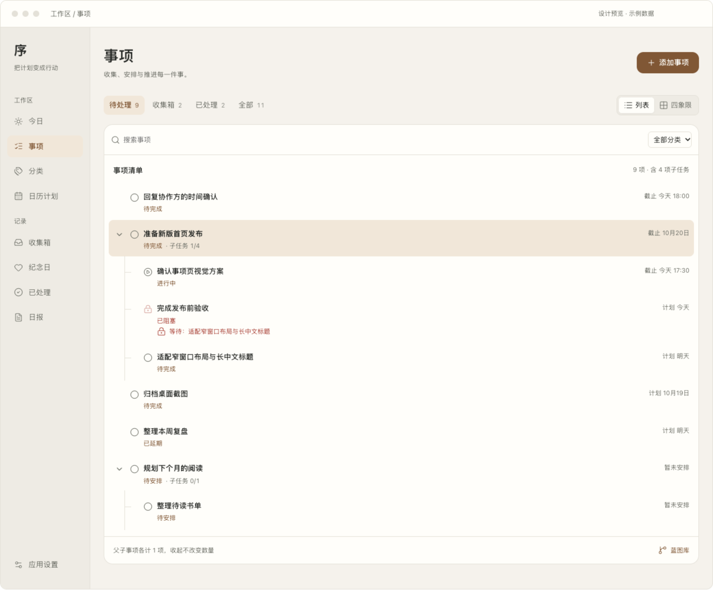
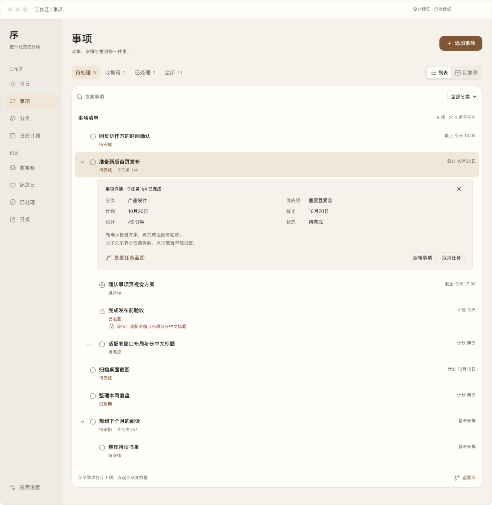
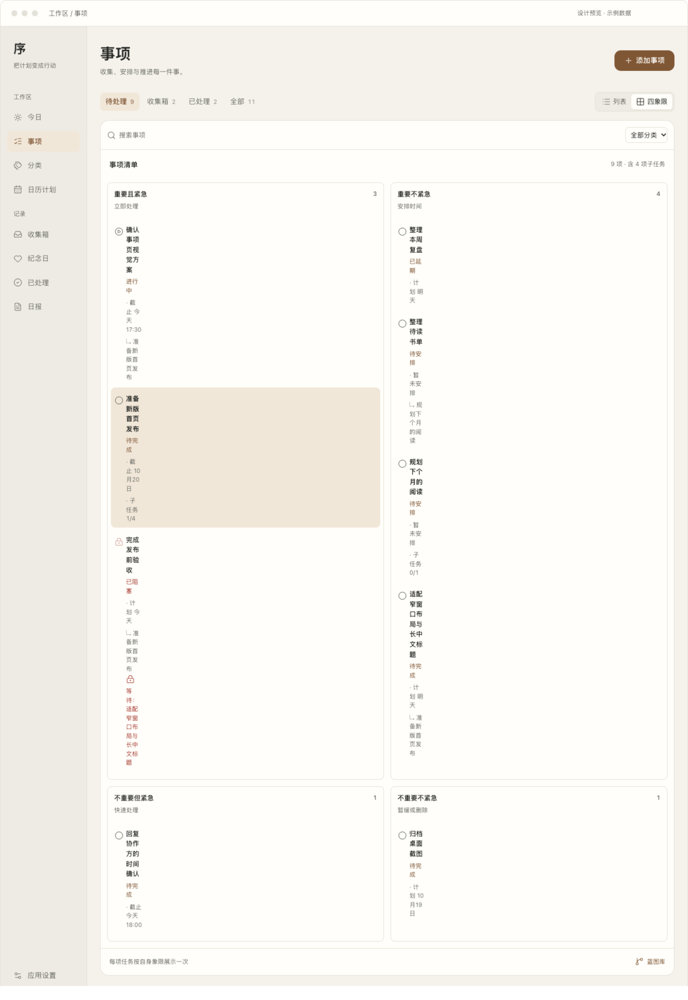
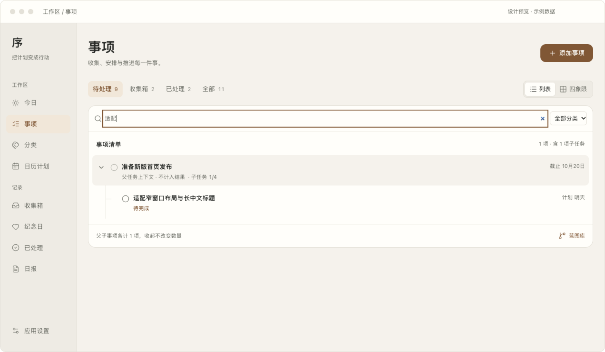
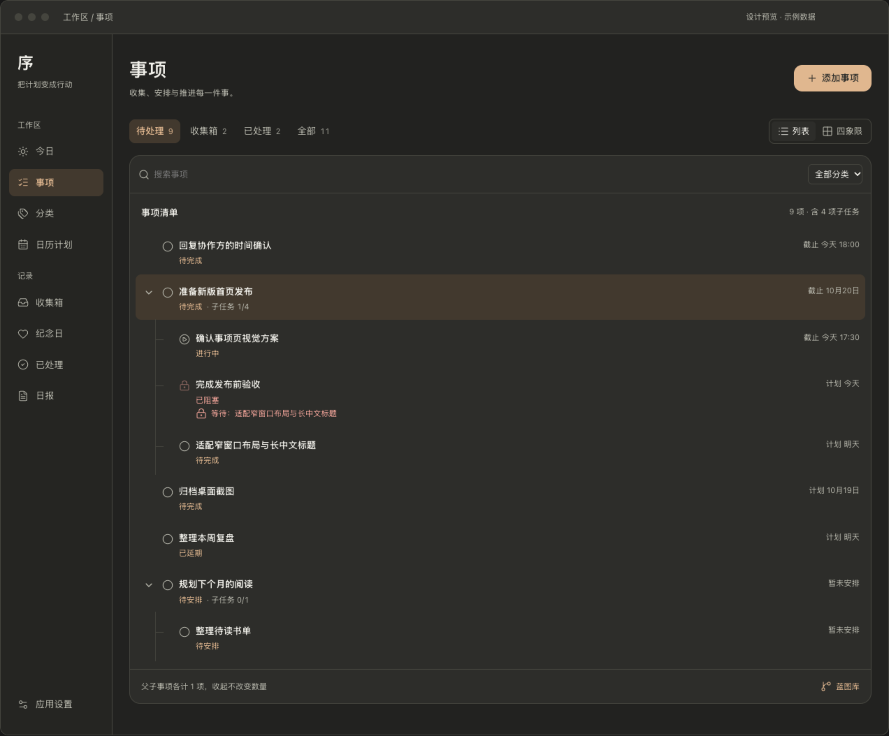

# macOS 工作区「事项」UI 设计稿 V2

日期：2026-10-17。基于当前工作区 `TasksHubView.swift`、`Views.swift` 中的 `TaskList` / `TaskCard`、`TaskItem` 状态规则与[任务视图架构](../task-views-architecture.md)整理。本稿专注 macOS；交付交互设计与视觉稿，尚未修改正式 SwiftUI 页面。

[打开交互设计稿](tasks-macos-v2.html)。默认展示「轻量浏览」，可切换「层级工作台」对照。所有任务都是预览内存数据，不连接真实任务库。

## 主方案：轻量浏览

首屏依次为「事项」页头、范围与视图、搜索与分类、事项清单。保留现有工作区侧边栏与记录入口；页头只有一个添加事项按钮。删除首屏的内部实现概念说明，改为简短的操作导向文案。

列表占满内容宽度。主任务通过展开箭头、略强字重、子任务进度识别；子任务通过缩进和细树形线表达归属。行内只保留完成、标题、状态、时间与子任务进度，避免每项都成为多层信息卡片。

时间明确标注「截止 今天 17:30」「计划 明天」或「暂未安排」，不把计划和截止混为同一种日期。截止与计划均存在时，列表优先显示截止，详情保留二者。

## 按需查看详情

点击标题在当前事项下展开轻量详情，再次点击同一标题或关闭按钮收起。详情显示分类、优先级、计划、截止、预计与状态，提供备注及低频操作。此处不重复整组子任务，也不再次显示一张大标题卡，避免把列表推离视线。

编辑继续进入现有 `TaskEditor`；任务蓝图使用现有投影/路由。宽窗口需要持续查看完整详情时，可使用备选「层级工作台」右侧详情布局。两种布局共用相同的范围、任务 ID 和状态语义。

## 四象限与筛选

范围回答「看哪些事项」，列表/四象限回答「如何展示」。搜索与分类归属清单内部；视图切换保留范围、搜索与分类条件。

列表筛选只命中子项时，补足父任务上下文并注明「不计入结果」，上下文行不可直接完成。四象限按每项任务自身属性显示一次；子项用父任务文字说明归属，不补入未命中的父任务，不强制子项继承父项象限。

## 深色与空态

无匹配结果提供「清除筛选」；没有待处理、收集箱为空、没有已处理事项分别使用对应说明。添加入口保持唯一。深色通过表面、分隔与文字层级区分区域；状态同时有图标和文字。

## 内部逻辑与边界

| 层级 | 数据或状态 | 设计约束 |
| --- | --- | --- |
| 唯一任务来源 | `TaskStore.tasks` / `TaskItem.id` | 列表、四象限与任务蓝图读取同一任务，不复制数据 |
| 范围 | 待处理 / 收集箱 / 已处理 / 全部 | 待处理是非完成、非取消；收集箱是待安排且待处理；已处理仅完成或取消 |
| 状态 | 待安排、待完成、进行中、已延期、已阻塞、已完成、已取消 | 延期与阻塞仍在待处理；无截止日期不能等同于收集箱 |
| 条件 | 范围 ∩ 搜索 ∩ 分类 | 范围徽标统计各自总量；内容计数统计当前交集；收集箱是待处理子集，范围数字不能相加 |
| 层级投影 | `parentTaskID` 与祖先上下文 | 父子各计一项；补足的上下文不计数；折叠不改变数量 |
| 子任务进度 | 已完成直接子项 / 全部直接子项 | 使用全体直接子项，不随筛选变化；已取消不算完成；主任务不会随子项自动完成 |
| 执行约束 | `dependencyIDs` / `executionBlockReason(for:)` | 父子关系不等于依赖；阻塞原因可见，完成/执行沿用 store 校验 |
| 排序 | 待处理在前、截止升序、创建降序 | 树内继续保持现有业务排序；不擅自按计划日期替代截止排序 |
| 蓝图 | 任务蓝图与旧 `BlueprintItem` | 从任务查看结构；蓝图库是次级入口；保留旧阶段、里程碑、依赖、空蓝图与返回路径 |
| 写入 | 完成、恢复、安排、编辑、创建 | 写入仍经过现有 store；重新投影同一组 ID，不能操作筛选结果的副本 |

选中项在条件变化后不再属于命中或祖先上下文时，详情跟随当前结果中的一项；无结果收起。列表与四象限切换不改变有效选中 ID。子任务保存后进入任务蓝图的既有规则、连续添加不跳转的规则，均继续保留。

## 与当前页面的差异

当前 `TaskList` 已有父子展开，本稿是在其基础上强化视觉关系，并增加筛选时的祖先上下文。搜索、分类筛选与页内轻量详情属于提议增加的呈现能力。取消从每行的常驻按钮下沉到详情；开始、延期、标记阻塞、象限调整、系统日历与删除，在正式实现中继续保留既有菜单及确认规则。

本原型只演示名称编辑、完成/恢复、取消、安排到今天与简化创建。创建表单未完整复刻正式「待办 / 已完成 / AI」类型、连续添加与全部执行校验。可检验信息结构，不应作为持久化或完整状态机实现复用。

## 落地与验证

- 页面使用 `AppTypography.desktop`、`AppSpacing`、`AppRadius`、`AppColors` 与用户主题，保留字号、字体、密度及 Reduce Motion 偏好；本稿的网页预览参数不应复制为业务页面硬编码。
- 添加使用现有 `AppButton(.prominent)`；搜索、分类、编辑使用原生控件。树投影可参考 `TodayTaskOutline` 的祖先补全与有限遍历，但不能引入「今日」日期范围。
- 不改任务模型、SwiftData、备份、同步格式及任务操作语义。正式迁移后再补原生 VoiceOver、焦点、全部状态与真实 macOS 窗口验收。
- 原型检查：父子标识、计划/截止文案、详情展开/收起、折叠后的计数、筛选上下文、四象限唯一归属、阻塞完成禁用、完成状态更新、新建子任务后的蓝图衔接，以及浅深色和 1024/760/390/320px 横向溢出。窄宽度仅为布局压力验证，不代表 iOS 设计范围。

本轮仅新增设计文档、原型及截图，未修改应用源码，未重新构建 `.app`。[上一版完整分析](tasks-macos-design.md)保留用于追溯。
