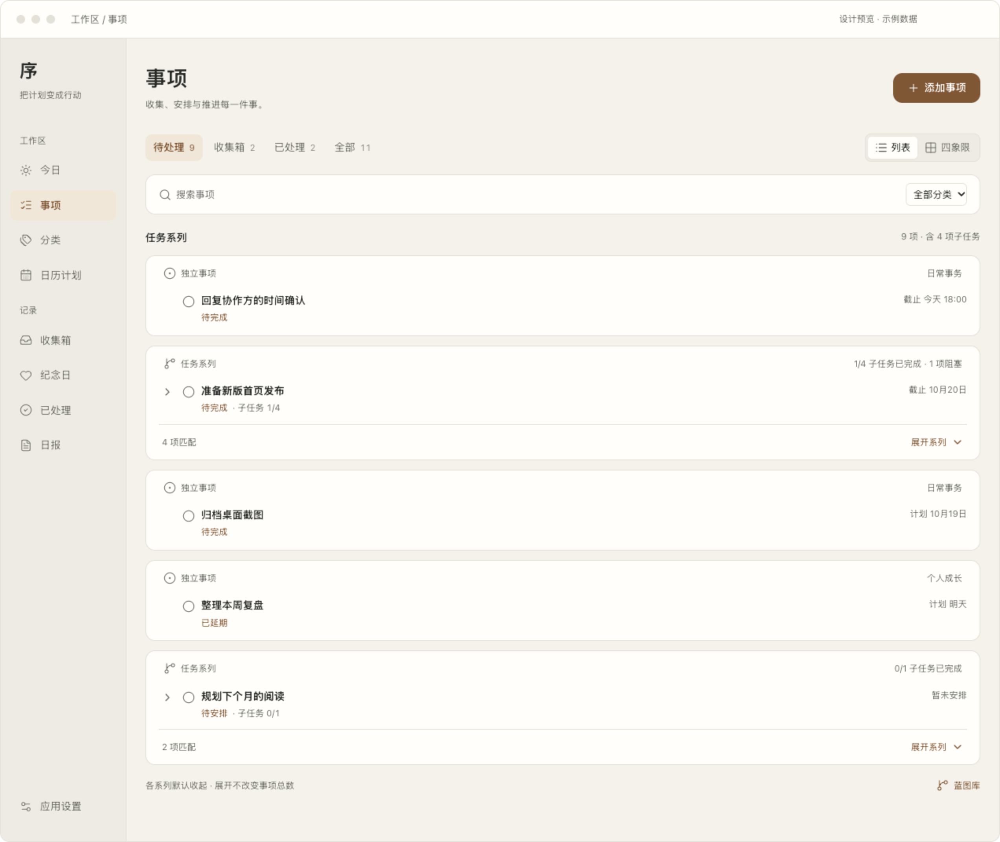
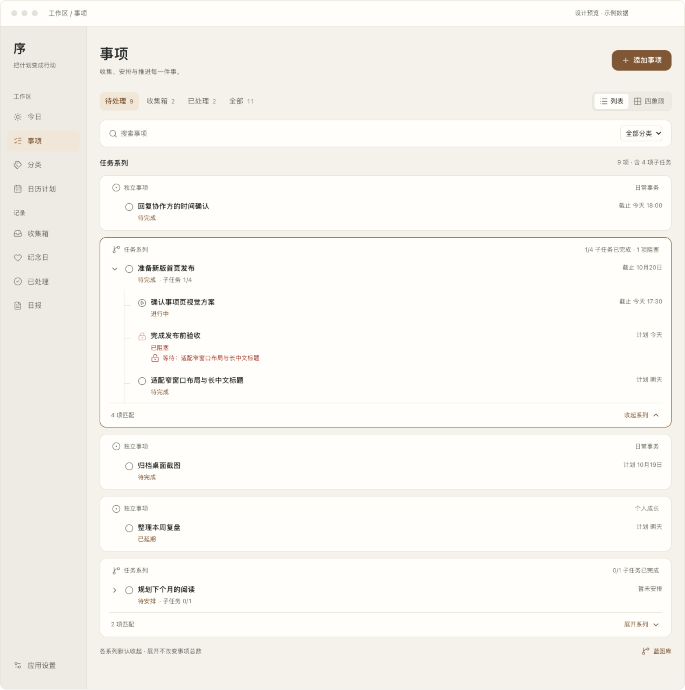
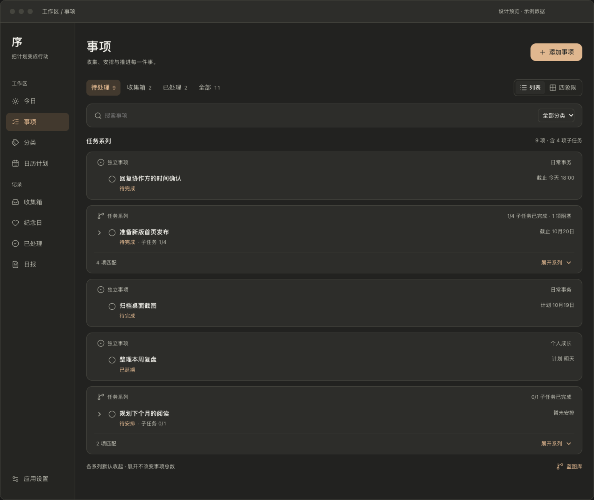
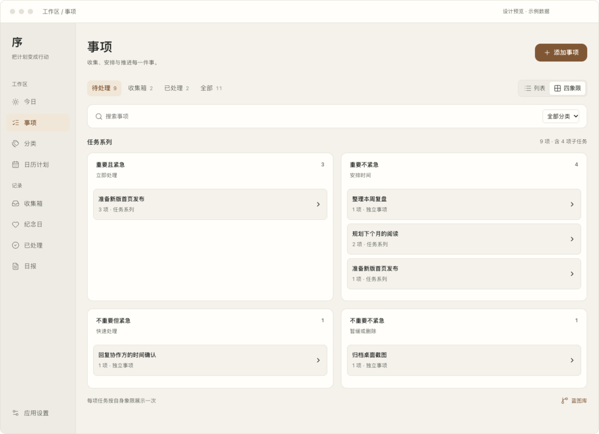

# macOS「事项」V3：系列分组，默认收起

基于 V2 更新。按用户要求，将每个任务系列明确区分，并将子任务与事项详情默认收起。[打开交互设计稿](tasks-macos-v3.html)。设计稿已于 2026-10-17 落到 macOS 事项页；实现与验证见[迁移记录](../rollout.md)。

## 默认状态

每个根任务及其子孙任务组成一个任务系列，占用独立卡片。卡片之间留出明确间距，避免不同系列的任务在同一张连续列表中混杂。没有子任务的独立事项也有自己的边界，并标为「独立事项」。不额外创建“系列”持久化对象。

系列卡片收起时显示主任务标题、状态、计划或截止、直接子任务完成进度及阻塞数量。左侧与主任务标题对齐的箭头是唯一的展开入口；卡片底部不再重复显示匹配数和展开操作。默认不显示子任务，也不打开详情。

## 展开状态

点击左侧箭头只展开该组；其他系列状态不变。子任务始终位于所属卡片内，以缩进、树形线与主任务建立联系。展开卡片用主题边框提示当前阅读范围。再次点击箭头收起。

当前实现中，点击任务行直接打开编辑弹窗；「更多」菜单的「查看详情」按需打开独立的只读事项详情弹窗，不在卡片内向下展开。系列展开使用单独箭头，箭头、完成圆圈和任务标题在同一视觉高度；详情弹窗仍提供关闭、编辑事项和查看任务蓝图操作。点击圆圈时先显示圆圈内的勾选和简短动画，再更新完成状态；Reduce Motion 下直接更新。完成主任务和完成子任务继续是独立操作，不能因收起、展开或子项全部完成而联动改变状态。

## 深色与四象限

四象限仍按每项任务自身象限取数，再在各象限内部按系列分组，组内任务默认收起。同一系列可以在不同象限出现对应分组，但一项任务只在自己的象限出现一次。组标题提供归属上下文，不作为额外任务计数。

## 交互与计数约定

- 首次进入与切换范围时，系列默认收起；事项详情关闭。当前范围内的筛选、完成和视图切换保留已有手动展开状态，不自动展开其他组。
- 新建系列默认收起。保存后进入任务蓝图的既有规则继续保留；返回清单时以收起卡片展示。
- 顶部数量仍按命中的任务 ID 统计，包含子任务；可见卡片数不等于任务数。展开、收起不改变计数。
- 系列内部继续按命中结果筛选，顶部数量取命中的任务 ID；子任务完成进度取全部直接子项，不混为一套口径。
- 筛选只命中子任务时，保留主任务上下文，卡片仍默认收起；展开后可查看匹配的子项。上下文不计数、不能直接完成，但仍显示父任务的真实状态：已完成时保留带勾圆圈、标题划线与「已完成」文字，点击勾选可恢复为待完成。
- 展开或收起仅为页面状态；不改变 `parentTaskID`、象限、任务完成状态、依赖、备份或同步格式。

## 验证与落地边界

原型检查覆盖：首次 5 个独立分组、子任务与详情全部收起、只展开一个系列、折叠不改数量、筛选子项归属、四象限默认分组收起及任务 ID 唯一、范围切换重置，以及浅深色与窄宽度横向溢出。

正式 SwiftUI 落地使用现有 `AppCard`、`AppSpacing.list`、`AppRadius`、`AppColors.border` 及 `AppPreferences` 主题；通过只读任务系列投影和页面折叠状态实现，不改任务模型。其他状态与操作规则沿用 [V2](tasks-macos-v2.md)。
