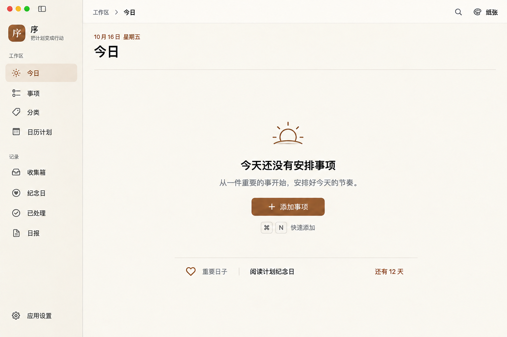

# macOS「今日」空状态设计提案 v4

日期：2026-10-16。供评审的空状态设计稿。由内置 imagegen 生成，重要日子内容为示例数据；本轮交付设计稿。



## 设计判断

此前空状态沿用了有任务页面的仪表盘骨架：大型列表容器、四象限零值筛选、今日进度 0/0 与多张无内容辅助卡片。新增面板或增加间距仍不能解决这些内容在空状态缺少实际用途的问题。

本版根据「今天尚未安排任务」组织界面：

- 保留侧栏与顶部导航；页头只显示日期和「今日」，用细分隔线界定内容区。
- 收起今日行动面板、四象限筛选、零值统计和空的接下来卡片；主区使用连续的页面底色。
- 空态主体由小型日出符号、明确说明、单一主操作和快捷键提示组成，整体在内容区中部稍偏上的位置呈现。
- 唯一「添加事项」按钮放在说明下方。页头同时省略添加按钮，保留一个新建入口。点击进入现有弹窗，创建类型在 Tab 中选择。
- 重要日子作为下方一条低强调信息，仅在有真实可展示内容时出现；没有内容时直接省略，不补空卡片。
- 日报仍可由侧栏进入；空状态主区集中引导安排今天的任务。

## 状态与转换

| 状态 | 呈现要求 |
| --- | --- |
| 今日没有安排任务 | 使用本稿，提供一次清楚的新建操作；文案同时适用于已有其他日期任务的用户。 |
| 创建第一条今日任务后 | 恢复有任务布局、今日进度与四象限筛选，添加入口回到页头；同一时刻只显示一个添加按钮。 |
| 今日任务均已处理 | 使用完成状态与真实进度，不能显示「今天还没有安排事项」。 |
| 四象限筛选结果为空 | 保留任务布局及筛选上下文，说明该象限暂无事项，并提供恢复全部的操作。 |

窗口适配时，空态主体与下方信息条作为内容组进行布局；矮窗口允许滚动，避免使用固定屏幕坐标强行居中。实际实现复用语义字体、现有 `AppButton` 及主题 token。日出图标表达尚待安排，完成状态使用独立文案和符号。

有任务页面仍参考 [v3](today-macos-redesign-v3.md)；任务及子任务、蓝图的语义沿用 [任务视图架构](../task-views-architecture.md)。

## 生成提示词

<details>
<summary>完整提示词；以 v3 空状态稿作为应用外壳与主题参考</summary>

```text
Use case: ui-mockup.
Redesign the EMPTY STATE of the macOS task planner "序" from first principles. Use the input image ONLY to preserve the existing app chrome, sidebar, native icon language and paper palette. The old dashboard empty layout is rejected. Recompose the ENTIRE content area into an elegant true empty state.

Output: one crisp high-fidelity straight-on Mac app window, same 1536x1024 framing as reference. Readable exact Chinese, PingFang/SF typography. Calm warm ivory canvas, muted brown brand, dark warm charcoal type, nuanced gray secondary text, very restrained borders. No photograph, device mockup, annotation, gradients, dramatic shadow, colorful illustration or marketing.

PRESERVE exactly: macOS traffic lights, left sidebar width250px, app "序" with caption "把计划变成行动", "工作区" nav 今日 selected / 事项 / 分类 / 日历计划, "记录" nav 收集箱 / 纪念日 / 已处理 / 日报, bottom 应用设置. Toolbar to right of sidebar: breadcrumb "工作区 › 今日", search icon, palette icon and theme "纸张".

NEW CONTENT COMPOSITION, right of sidebar:
- ONE continuous warm ivory page. NO two-column dashboard, NO right rail, NO huge white card. Content uses full available width.
- Compact quiet PAGE HEADER: at x~310,y~110 small brown "10月16日 星期五"; beneath it x310,y148 title "今日" around34px semibold. Remove old motivational subtitle. Across content, a single extremely subtle separator at y215 fromx310 tox1476 distinguishes header from workspace. NO add button in this header: creation moves to the empty prompt, maintaining exactly ONE entry.
- A thoughtfully balanced central empty-state composition at the optical center of available content (center x~890,y~490). It must sit naturally on the plain page canvas without ANY enclosing rectangle or card. Avoid positioning everything at the very bottom or huge uncontrolled blank gaps.
- At top of this centered composition around y340, a small delicate sun-over-horizon SF-style outline symbol in muted warm brown, ~58px; no checkmark (nothing has been completed), no large cartoon.
- Beneath with a32px gap, centered heading "今天还没有安排事项" around26px semibold, clearly smaller than page title and beautifully spaced.
- One centered secondary sentence beneath: "从一件重要的事开始，安排好今天的节奏。" around16px gray.
- 28px beneath the description, the ONLY task-creation control in the entire window: a compact native-looking brown filled button "+ 添加事项" approximately150x42px,12px corner radius. NO dropdown arrow, NO split segment, NO vertical separator. Exact correct Chinese label. It opens the existing creation modal where tabs select task types.
- 14px below button, a small quiet keyboard hint using subtle keycaps "⌘ N" followed by "快速添加", secondary gray at12px. It is a shortcut hint, not a second button.
- Centered content from icon to shortcut should occupy roughly260px total height with precise spacing and optical weight, surrounded by breathing room.
- One subdued contextual strip near y820 centered below hero, width~640px. Hairline divider above; beneath one aligned row: tiny heart outline, small muted label "重要日子", text "阅读计划纪念日", far-right small brown "还有12天". No enclosing rounded card, no big heading, no daily report button in this strip. This is illustrative actual available anniversary content, secondary to main prompt.
- All remaining page space intentional calm background, not boxed blank surfaces.

ABSOLUTELY EXCLUDE old elements: "今日行动" heading, "全部0" or any quadrant filters, "今日进度", "0/0", "待处理0项", "预计0分钟", empty progress bar, "接下来" empty card, "关联蓝图", "按蓝图分组", report action card, fake focus task card, onboarding steps/tutorial, sample task rows, fake statistics. Empty means no tasks scheduled today; do not claim all tasks completed.

Visual goal: minimal, polished, welcoming, native Apple productivity app, clear first action. Deliberate groupings and ample whitespace, no dashboard scaffolding in the absence of data. Sharp UI, not a loose concept illustration.
```

</details>

