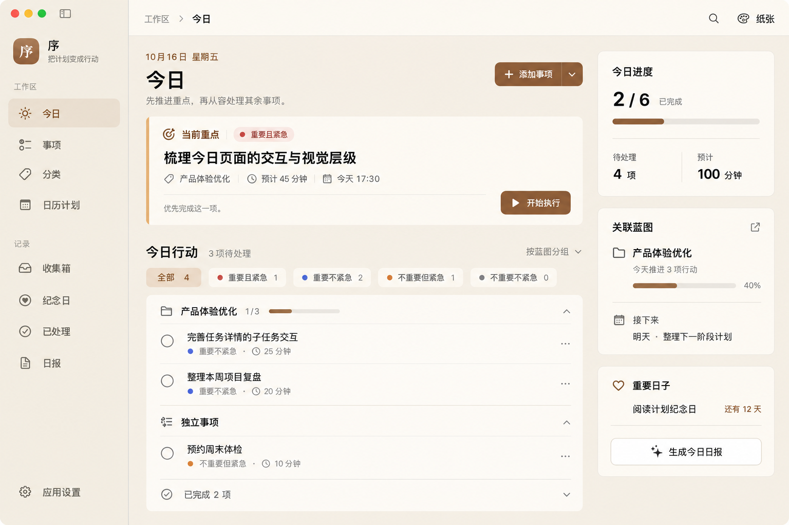
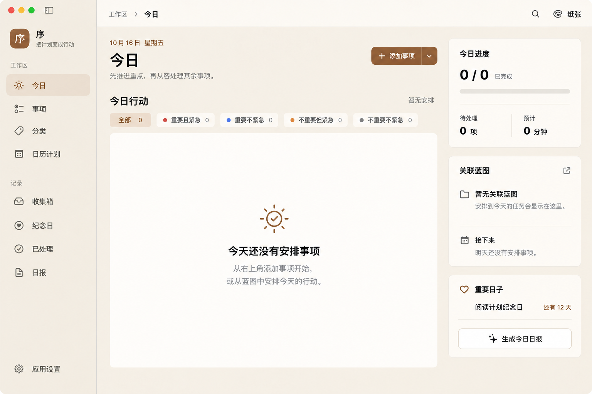

# macOS「今日」页面设计提案 v1

本版保留作为历史提案。其中「关联蓝图」「按蓝图分组」沿用了蓝图作为独立容器的旧表达，已由 [v2](today-macos-redesign-v2.md) 改为任务及父子结构。

日期：2026-10-16。阶段：供评审的高保真设计稿，尚未落地应用。使用内置 imagegen 生成；以当前 `dist/序.app` 的「今日」页面截图为布局和品牌参考。画面中的任务、蓝图、进度和纪念日均为示例数据。

## 有任务状态



## 空状态



## 布局方向

- 保留现有 macOS 侧边栏、顶部导航、搜索、皮肤入口及纸张主题。
- 页头收紧为日期、「今日」标题与短说明；「添加事项」组合控件作为页面唯一新建入口，空态与有数据状态保持同一位置。
- 有任务时，以当前重点卡片和分组任务列表形成主要阅读顺序；空态时直接展示今日行动列表的空状态，避免多个空卡片重复说明。
- 四象限数量与筛选合并为列表上方的轻量控件；当前重点始终置顶，沿用现有筛选行为。
- 右侧辅助区依次展示今日进度、关联蓝图与接下来、重要日子和日报操作。
- 记录已完成与 AI 生成继续放在唯一新建控件的菜单中；主任务不在下方列表重复显示。

## 后续实现对照

优先复用现有 `AddTaskControl`、`AppButton`、列表业务行和设计系统 token。最终尺寸、字重、颜色、点击区域与窄窗口折行以 SwiftUI 的语义样式和现有用户偏好为准。示例计数在实现中应由真实数据统一推导；关联蓝图的长期进度与今日任务完成进度使用各自的数据口径。

本轮只交付设计稿。窗口适配、深色主题、字号偏好与辅助功能需要在落地阶段核对。

## 生成提示词

### 有任务状态（参考当前应用截图）

<details>
<summary>完整提示词</summary>

```text
Use case: ui-mockup
Create a polished high-fidelity UI design proposal for the CURRENT macOS task planning application "序", redesigning only its Today page. The most recent conversation screenshot is the reference image: preserve the app's identity, paper theme, sidebar structure and native macOS feel, but substantially improve the information hierarchy and spatial composition. This is a review mockup, not a photograph. Render a single large straight-on application window, 1800x1200 landscape, very crisp Chinese UI typography. No device frame, perspective, background props, marketing copy, decorative illustration, or annotations outside the window.

Art direction: beautifully restrained, native Mac productivity application. Warm off-white canvas, slightly contrasting very light sidebar, white paper surfaces, subtle warm-gray rules, warm muted brown accent used sparingly; excellent contrast and generous whitespace. SF Pro / PingFang Chinese system font. Calm, precise typography and optical alignment. Elegant rectangular surfaces with restrained 12-16px radii, almost no shadow. Avoid excessively rounded pill cards or dramatic dark hero cards. Icon language is thin SF Symbols. Keep a useful desktop information density: less giant empty padding than reference.

Window layout:
1. Native traffic lights at upper left. Fixed sidebar 210pt wide, app icon and name "序" and secondary caption "把计划变成行动". Section "工作区" with rows "今日" (selected with understated warm brown highlight), "事项", "分类", "日历计划"; section "记录" with "收集箱", "纪念日", "已处理", "日报"; bottom aligned "应用设置". Maintain sidebar alignment and spacing of a Mac app.
2. Slim top toolbar across content, breadcrumb "工作区  ›  今日" left, search icon and "纸张" theme menu right. No add task button in toolbar.
3. Content inset 40pt. Page header has small muted date "10月16日 星期五", compact strong page title "今日" below; light subtitle "先推进重点，再从容处理其余事项。". At far right of SAME header put the only task-creation entry anywhere in the screen: a restrained filled brown split control "+ 添加事项  ﹀". No additional add links/buttons in cards or lists.
4. Below header: two columns, left main ~760pt, right ~270pt, gutter 28pt. Main column starts with a refined focus card (height about 210pt, white with subtle warm tint on left edge; not dark): top small label "当前重点" with scope icon and subtle "重要且紧急" priority badge; task title "梳理今日页面的交互与视觉层级", small metadata "产品体验优化  ·  预计 45 分钟  ·  今天 17:30". Bottom left subtle "优先完成这一项"; bottom right one brown button with play icon "开始执行". Purposeful whitespace, no huge lettering.
5. Main column below focus: section title "今日行动" with "3 项待处理" in muted text; small right sorting label "按蓝图分组". Under it, compact inline filtering row: "全部 4" selected, then four subtle text filters with tiny colored priority dots and counts: "重要且紧急 1", "重要不紧急 2", "不重要但紧急 1", "不重要不紧急 0". These are lightweight list filters, not four large dashboard tiles.
6. Task groups in a single clean white list surface with thin dividers, NO card per task. Header "产品体验优化" with blueprint icon, muted "1/3" and tiny progress line. Two task rows with circular empty checkbox left: "完善任务详情的子任务交互" secondary metadata "重要不紧急 · 25 分钟"; "整理本周项目复盘" metadata "重要不紧急 · 20 分钟". Right ends have very light ellipsis controls. Second group header "独立事项", one row "预约周末体检" metadata "不重要但紧急 · 10 分钟". Bottom a subdued collapsed row "已完成 2 项" with chevron. No duplicate of the focus task in the list.
7. Right rail, three well-spaced modest surfaces or sections, aligned to focus top:
- "今日进度": "2 / 6" completion figure with "已完成" label, a thin progress bar at one third, a divider, and compact statistics "待处理 4 项" and "预计 100 分钟". Native clear typography, not oversized metric tiles.
- "关联蓝图": project "产品体验优化", muted subtitle "今天推进 3 项行动", progress line and "40%" (progress relates whole blueprint, independent of today's completion). Small top-right open icon. Below divider "接下来" with calendar icon, "明天 · 整理下一阶段计划".
- "重要日子": heart icon, example "阅读计划纪念日" and "还有 12 天". Below a quiet secondary button with sparkle icon "生成今日日报". It should be available without competing with task creation.
No charts, illustrations, floating controls, extra global navigation, iOS elements, English filler or invented features. Exactly ONE visible "添加事项" creation control. Design sample task names are illustrative. Prioritize a convincing professional native Mac application, readable correct Chinese, meticulous spacing, and a strong focus-to-list visual flow.
```

</details>

### 空状态（以前一张设计稿为编辑目标）

<details>
<summary>完整提示词</summary>

```text
Use case: ui-mockup
Edit the most recent generated image, the new macOS "序" Today page design, into the matching EMPTY STATE version. Keep the exact same overall window size, straight-on view, sidebar and its selected "今日" row, native traffic lights, toolbar breadcrumbs/search/theme, paper colors, typography, page title/date/subtitle, and ONLY ONE creation control "+ 添加事项 ﹀" at the top right of the MAIN COLUMN. The reference image is the edit target. This must look like the very same application layout in a different data state, not an alternative design.

Main column changes:
- Remove the entire current-focus task card because there are no tasks.
- Immediately under the page title/subtitle, at the former focus card top edge, show the section heading "今日行动" and right muted text "暂无安排".
- A quiet four-quadrant filter row remains below it, with "全部 0" selected, followed by "重要且紧急 0", "重要不紧急 0", "不重要但紧急 0", "不重要不紧急 0". Treat these as lightweight compact controls, with very restrained contrast when all are zero.
- Under the filters, one white empty list surface about 440px tall, vertically centered contents with a small thin brown SF-style sun/checklist icon, heading "今天还没有安排事项", smaller two-line muted explanation "从右上角添加事项开始，" then "或从蓝图中安排今天的行动。". No button, no add link inside this panel. Maintain clear air and elegant alignment. No giant decorative illustration. No focus placeholder card, no duplicate empty panels, no fake skeleton tasks, no task rows or completed section.
- Useful warm canvas negative space below the empty surface, no extra controls.

Right rail:
- Same position and width as reference. "今日进度" card now reads "0 / 0" and "已完成", thin unfilled progress track, below "待处理 0 项" and "预计 0 分钟". No fake progress.
- "关联蓝图" card reads "暂无关联蓝图" with smaller muted "安排到今天的任务会显示在这里。" then a divider and "接下来" plus text "明天还没有安排事项。". No new creation control in this card.
- Preserve the third "重要日子" card with the illustrative reading anniversary, "还有 12 天", and the quiet "生成今日日报" action. This report button is not an add-task action.
All Chinese text sharp, correct and legible, native desktop macOS aesthetic, warm neutral paper theme, good contrast, perfectly aligned. Exactly one task-creation entry on the screen, in the page header. No invented features. No annotations outside the app window.
```

</details>

