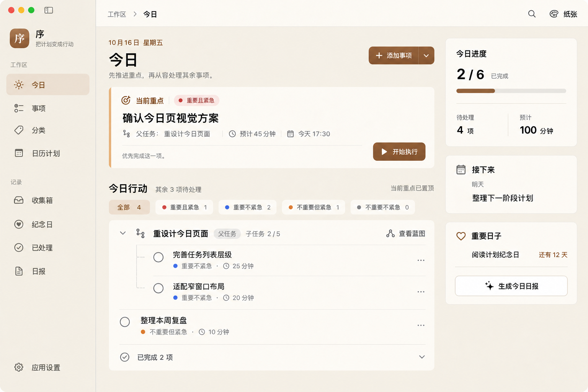
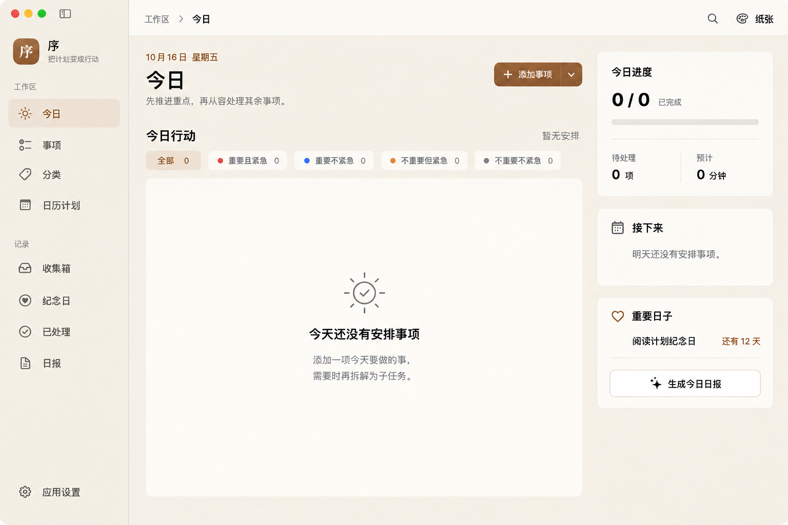

# macOS「今日」页面设计提案 v2

本版作为历史提案保留。[v3](today-macos-redesign-v3.md) 已优化空状态分区，并将添加入口改为普通按钮；任务类型通过创建弹窗内的 Tab 选择。

日期：2026-10-16。供评审的设计稿，使用内置 imagegen 生成，图中为示例数据。当前版本以任务及父子结构组织「今日」，替代 v1 中将蓝图作为独立项目容器的表达。

## 有任务状态



## 空状态



## 产品语义

- 任务是基础实体，子任务也是任务；父子关系表达拆解，执行依赖表达前置条件，二者分别处理。
- 蓝图是同一批任务及子任务的关系与执行视图。列表、蓝图、四象限读取相同任务 ID 和状态。
- 今日页显示今天安排的任务。列表采用任务层级，必要时显示父任务作为归属上下文；上下文父任务不因出现在页面上而计入今日任务数。
- 「查看蓝图」打开所属任务树，并定位当前任务；它是任务视图入口。
- 右侧显示今日进度、接下来和重要日子，移除 v1 的「关联蓝图」项目卡；列表移除「按蓝图分组」。
- 唯一新建入口位于页头，记录已完成与 AI 生成继续放在该入口的菜单内。

## 示例数据与计数

图中「重设计今日页面」是未安排今天的父任务，仅作归属上下文。它的五条子任务中，两条完成、一条作为当前重点置顶、两条在列表中待处理；另有一条独立待处理任务。

因此今日共 6 条任务，完成 2 条、待处理 4 条，预计投入 100 分钟。父任务的「子任务 2/5」表示其任务树进度；其完成状态独立管理。重点任务在卡片出现后不在下方重复列出，列表提示「其余 3 项待处理」与「当前重点已置顶」。

## 视觉方向与落地边界

沿用纸张主题、紧凑页头、重点卡片、轻量四象限筛选、主任务区和辅助信息区。实际实现需复用现有设计系统 token、主题与字号偏好。窄窗口、深色、长名称、多级任务展开与辅助功能应在实施阶段核对。本轮交付设计稿。

产品语义依据：[任务视图架构](../task-views-architecture.md)。

## 生成提示词

### 有任务状态

<details>
<summary>完整提示词；以 v1 有任务稿为编辑目标</summary>

```text
Edit this macOS "序" Today page UI design image into version 2. Keep the exact window, paper theme, native sidebar, toolbar, header typography, spacing, single "+ 添加事项" split button, and calm white main surfaces. Correct a conceptual mistake: a BLUEPRINT IS A VIEW OF THE SAME TASKS AND SUBTASK RELATIONS. It is NOT a separate project/container that tasks are assigned to. Parent tasks and child tasks are the base entities. The hierarchy shows decomposition, not execution blocking; no sequential arrows in list.

REQUIRED PRECISE CHANGES:
1. Remove the entire "关联蓝图" right rail card and all its project/progress association content. Replace that middle card with a simpler "接下来" card with calendar icon and muted date "明天", example task "整理下一阶段计划". No project or blueprint progress here.
2. Remove "按蓝图分组" above task list. In that location put small muted text "当前重点已置顶". The section is titled "今日行动" with subtitle "其余 3 项待处理".
3. Current focus card: retain its size and styling. Task title becomes "确认今日页视觉方案". Small parent-context breadcrumb with a branch icon reads "父任务：重设计今日页面". Other metadata reads "预计 45 分钟 · 今天 17:30". Keep "重要且紧急" badge and "开始执行" button. No separate project name.
4. Rebuild the task list surface to express a TASK TREE rather than project/folder groups. At top of list, a disclosure chevron with a hierarchy branch icon and bold task name "重设计今日页面", small muted label "父任务" and small "子任务 2/5". At right a quiet text action with graph icon "查看蓝图". Do not use a folder icon. This parent row is contextual because the parent is not scheduled today; it has no completion checkbox and is not counted as a today task. Under it show two INDENTED subtask rows, round actionable checkboxes aligned on a child column, subtle short tree branch guide lines:
- "完善任务列表层级", small metadata "重要不紧急 · 25 分钟"
- "适配窄窗口布局", small metadata "重要不紧急 · 20 分钟"
The focused third pending child is already in the focus card above and must not be repeated. Two completed children are collapsed in the completed row below. Thus parent has five children: two completed, one focused, two pending shown.
Below a thin divider, show a standalone TASK row at the unindented task level with checkbox, title "整理本周复盘", metadata "不重要但紧急 · 10 分钟", ellipsis at right. No "独立事项" folder/group heading.
Bottom subdued collapsed row "已完成 2 项".
Make parent-child indentation visually obvious but restrained, with adequate label width and excellent optical alignment.
5. Keep four-quadrant filters as reference, counts "全部 4", "重要且紧急 1", "重要不紧急 2", "不重要但紧急 1", "不重要不紧急 0".
6. Keep right rail TODAY progress "2 / 6", "待处理 4 项", "预计 100 分钟". These count only SIX ACTUAL TASKS SCHEDULED TODAY, excluding the contextual parent. Root subtask progress 2/5 is separate.
7. Keep important anniversary and report button in third card. Exactly one new-task creation control globally in page header. "查看蓝图" only opens the same root task's graph of tasks and subtasks, not a new entity. No wording "关联蓝图", "按蓝图分组", "蓝图进度", "项目" or "归入蓝图" anywhere.
Keep excellent readable Chinese, beautifully restrained native macOS appearance and clean white paper surfaces. Produce one full application screen with the same framing as input.
```

</details>

### 空状态

<details>
<summary>完整提示词；以 v2 有任务稿为编辑目标</summary>

```text
Edit the most recent generated macOS "序" Today page v2 image into its matching empty state. Use the image as the edit target; preserve the exact sidebar, toolbar, paper theme, title/date/subtitle, only one "+ 添加事项" control, native typography and column widths.
There are no tasks scheduled today. Remove the focus card completely. Below page heading show "今日行动" and right "暂无安排". Under it keep compact filters, all zero: "全部 0", "重要且紧急 0", "重要不紧急 0", "不重要但紧急 0", "不重要不紧急 0". Replace task tree with one white empty list surface around 440px tall. Center a small fine-line sun/checkmark icon, heading "今天还没有安排事项", and muted explanation "添加一项今天要做的事，" on first line and "需要时再拆解为子任务。" on second. No extra add button/link. No placeholder parent task, no fake rows, no completed footer.
Right rail keep EXACT v2 structure: "今日进度" card with "0 / 0 已完成", empty progress track, "待处理 0 项", "预计 0 分钟"; middle card "接下来", calendar icon, text "明天还没有安排事项。"; bottom card "重要日子", illustrative "阅读计划纪念日", "还有 12 天", quiet report action "生成今日日报".
No "关联蓝图", no "按蓝图分组", no "蓝图进度", no project containers. A blueprint is a view of the same tasks and subtask relationships and has no separate empty state on Today. Retain the polished Mac proportions and optical alignment of the reference. One full straight-on app window.
```

</details>

