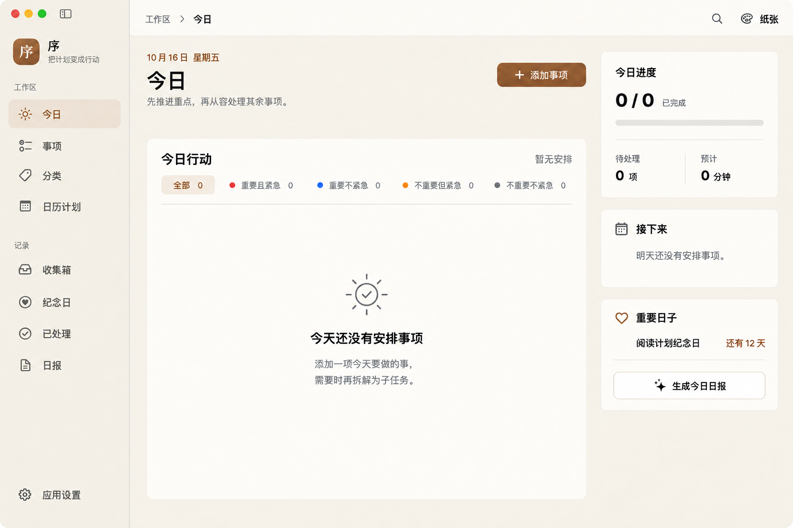
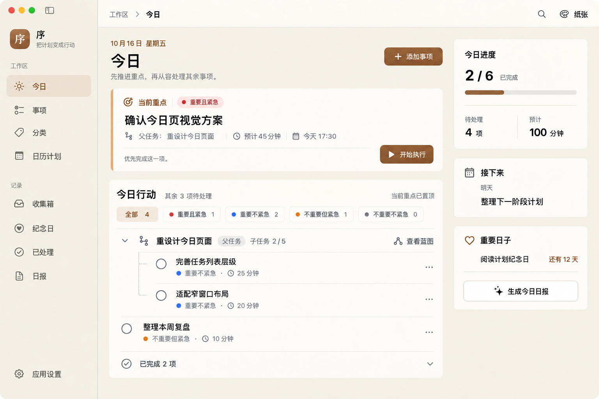

# macOS「今日」页面设计提案 v3

空状态已由 [v4](today-macos-empty-v4.md) 重新组织：收起空的仪表盘结构，采用单一操作的简洁空态。有任务设计稿继续保留本版。

日期：2026-10-16。供评审的设计稿，使用内置 imagegen 编辑 v2，图中内容为示例数据。本版调整空状态的分区层级，并将添加入口改为单一按钮。

## 空状态



## 有任务状态



## 本次调整

- 页头仍包含日期、「今日」、短说明与唯一的「添加事项」按钮。
- 「今日行动」标题、四象限筛选、列表或空态内容收进同一张白色面板，以容器归属区分页头和行动区。
- 空状态在页头说明下预留清楚的分区间距，再显示行动面板；当前重点为空时，直接省略该重点卡片。
- 有任务时，重点卡片独立在上方，下面的行动面板采用同一内部结构。
- 「添加事项」使用普通按钮，去掉下拉箭头、菜单分段与分隔线。点击进入现有创建弹窗，待办、已完成、AI 生成等类型通过弹窗中的 Tab 选择。
- 两种状态都只保留一个添加事项入口。

## 产品语义与落地

沿用 [v2](today-macos-redesign-v2.md) 的任务、子任务与蓝图关系：蓝图是同一任务集合的关系与执行视图，父子关系和执行依赖分别表达；列表的父任务上下文不额外计入今日任务，置顶重点不重复列出。

后续实现普通添加按钮时应使用现有 `AppButton` 的页面主要操作样式；本设计替代 v2 在今日页使用 `AddTaskControl` 分段菜单的方案。任务类型入口集中到现有弹窗 Tab。本轮为设计稿，实际按钮尺寸、面板间距、字号适配与主题映射应统一使用现有设计系统 token。

## 生成提示词

### 空状态

<details>
<summary>完整提示词（以 v2 空状态稿为编辑目标）</summary>

```text
Use case: ui-mockup. Carefully edit this EMPTY STATE design of the native macOS task app "序" into v3. The input image is the exact edit target. Preserve its window size/framing, sidebar, paper palette, toolbar, date, page title, subtitle, right rail, font system and visual quality. Make TWO SPECIFIC DESIGN IMPROVEMENTS, with obvious results:

A. Clearly separate the page header "今日" from the "今日行动" section when the focus/execution task card is absent. Do NOT insert any placeholder focus card. Rather, turn the entire "今日行动" section into ONE COHERENT WHITE PANEL that CONTAINS its heading, its filters, and its empty state.
In image coordinates assuming input 1536x1024:
- Keep the page header/date/title/subtitle exactly around its current y100..205.
- Under subtitle leave a deliberate 60px breathing zone before the task PANEL begins at approximately y270, x285, width850, bottom around y940. This panel has the same restrained 12px corner radius and white surface as current design. All task-section content now belongs INSIDE this panel.
- Panel inner padding 28px. Top row inside panel at y310: section title "今日行动" at left, quiet "暂无安排" at right. This title must look distinctly subordinate to the page title and sit INSIDE the white panel, NOT floating just beneath "今日" on the beige canvas.
- Beneath panel heading at y355, compact filter controls IN the panel: "全部 0" selected, "重要且紧急 0", "重要不紧急 0", "不重要但紧急 0", "不重要不紧急 0". Fit within its inner width; use fine native typography and compact spacing, do not squeeze labels into overlap. Filters need no huge pill backgrounds. A fine warm-gray divider below the filter strip defines the list body.
- Center small sun/checkmark symbol around y620 and empty text below it, with ample meaningful white space. Text: "今天还没有安排事项"; smaller two lines "添加一项今天要做的事，" and "需要时再拆解为子任务。".
- No duplicate action title, no other white card around empty text within the enclosing task panel, no empty fake executing card, no huge unstructured empty gap to mimic a missing focus card.
The result should communicate two DISTINCT semantic sections: spacious page introduction above, task-list panel below. Better grouped and more beautiful than input.

B. Replace the split "+ 添加事项  v" control with ONE NORMAL filled brown button "+ 添加事项". Completely remove the dropdown chevron and the vertical split separator, and REMOVE the now-empty dropdown segment so the button becomes naturally narrower. Keep its right edge aligned with the main task panel right edge, its current header placement and visible height. Icon plus and text centered. This SINGLE button directly opens an existing creation dialog, where task types are selected using TABS; there is no dropdown menu here. No other add button/link on screen.

Right rail unchanged: "今日进度" 0/0 with empty progress and 0 pending, 0 minutes; "接下来" no tasks tomorrow; "重要日子" reading anniversary 12 days, report button. Do NOT reintroduce "关联蓝图" or "按蓝图分组". No relationship panel in empty state.
Render precise readable Chinese, restrained native macOS control styling, warm paper and brown accent, generous yet purposeful spatial grouping. One full window matching input, not a comparison board, no arrows/annotations/device mockup.
```

</details>

### 有任务状态

<details>
<summary>完整提示词（以 v2 有任务稿为编辑目标）</summary>

```text
Use case: ui-mockup. Edit the provided POPULATED v2 design of native macOS "序" Today into v3, matching the improved grouped-panel structure. Preserve the window framing, exact sidebar, warm paper colors, toolbar, title/date/subtitle, current focus card and ALL task names, parent-child semantics, progress data and right rail content. Two precise changes:

1. Header creation control: replace the split "+ 添加事项 v" control with ONE regular filled brown button "+ 添加事项". Remove the dropdown arrow, vertical divider and entire separate dropdown segment. Natural single-button width, plus symbol and label centered, right aligned to main column edge. This opens the existing task creation dialog, whose tabs select task types. No menu here, no second add entry.

2. Make "今日行动" into ONE unified white panel containing its section heading, filter strip, task tree list and completed footer. In the current image the heading and filters float on beige ABOVE the white list; now extend the list's white surface upward to enclose these controls as well. Keep a clear 28-32px vertical gap from bottom of focus card to top of this action panel. Suggested original1536x1024 coords: focus remains x285 y227 width850 height212; action panel x285 y470 width850 bottom~970; inner padding26. Heading "今日行动" at x312 y500 with muted "其余 3 项待处理", right small "当前重点已置顶". Filters at y546 inside white panel: "全部 4" selected, small colored dots and "重要且紧急 1", "重要不紧急 2", "不重要但紧急 1", "不重要不紧急 0". Use compact text controls and selected warm backing only on "全部". Fine divider below filters. Root row aroundy600: chevron, branch icon, "重设计今日页面", muted "父任务", "子任务 2/5", quiet graph action "查看蓝图". Child rows indented with faint tree guides, titles "完善任务列表层级" (25分钟) and "适配窄窗口布局" (20分钟); below them independent row "整理本周复盘" (10分钟); bottom "已完成 2 项". Slightly compact row spacing if needed but keep good readability. No separate inner white card around task rows: one cohesive surface. Preserve empty checkboxes, ellipsis menus, hierarchy and blue/orange priority dots.

Current focus card stays: "当前重点", "重要且紧急", title "确认今日页视觉方案", metadata "父任务：重设计今日页面", "预计45分钟", "今天17:30", play action "开始执行". Do not duplicate that focus task in the list.
Right rail stays "今日进度 2/6 已完成", 4 pending,100minutes; "接下来 明天 整理下一阶段计划"; "重要日子 阅读计划纪念日 还有12天" and report action. Blueprint is a view of tasks/subtasks, not a project container. No "关联蓝图"/"按蓝图分组". One whole straight-on app window, sharp accurate Chinese, elegantly aligned native Mac design.
```

</details>

